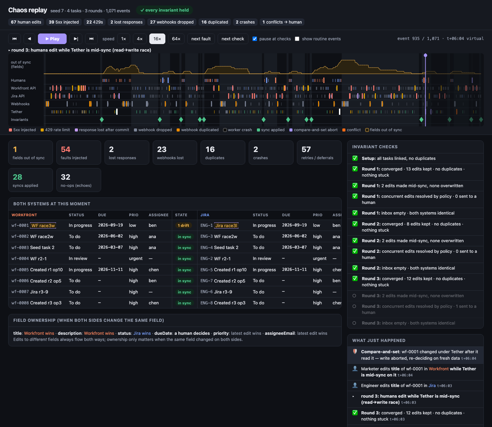
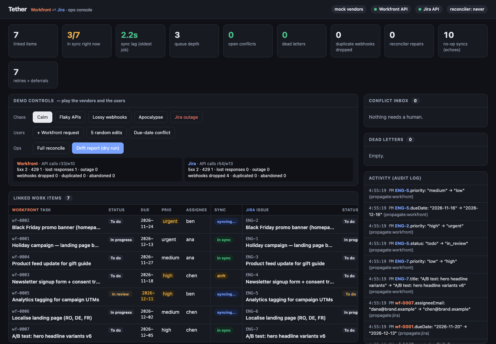
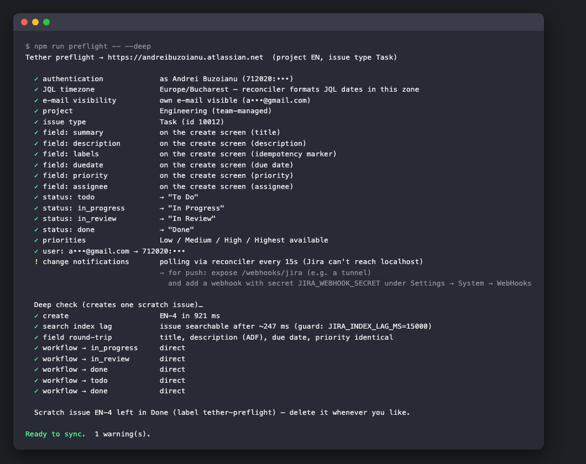
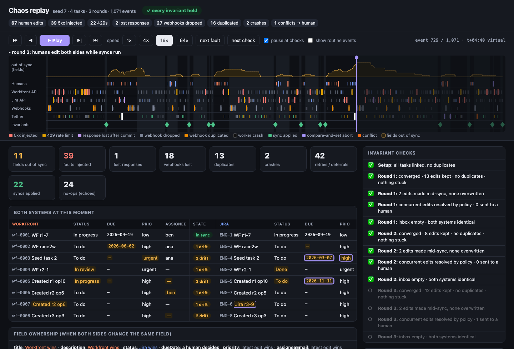

# Tether

A two-way sync between **Adobe Workfront** and **Jira Cloud**: Workfront is where marketing plans the work, Jira is
where engineering delivers it.

The brief asked for a glue service that handles conflicts, retries and partial failures. I spent most of my time on
those three things, because they decide whether a sync tool is trusted or turned off after a month.

```
  Workfront  ──webhook──▶ ┌───────────────────────────────┐ ◀──webhook / poll──  Jira
  (the plan)              │  Tether                       │                     (the delivery)
             ◀──REST────  │  queue · merge · retries ·    │  ──REST──────────▶
                          │  reconciler · conflict inbox  │
                          └───────────────────────────────┘
```

**Short version**

- Each field has an owner. Marketing owns the brief, engineering owns the status, and if the launch date changes on
  both sides, a person decides. Edits to different fields never overwrite each other.
- Webhooks only tell Tether *which* item to look at. Every sync re-reads both systems, so duplicate, late, reordered or
  missing webhooks don't matter. A reconciler catches anything a webhook never reported.
- A lost response, a crash mid-sync, or a Jira workflow move that fails half-way are all finished by the next run.
  Tether doesn't lose a person's edit and doesn't create a duplicate issue.
- It runs against a **real Jira Cloud site**. Workfront is mocked because it has no free tier.
- I tested it with a seeded chaos simulation: **500 of 500 seeds pass**. Any seed can be replayed as an interactive
  timeline. The simulation found five real bugs in my design while I was building it, and two more came from the demo
  and from testing against real Jira. All seven are now regression tests
  ([the story](docs/design.md#what-the-chaos-simulation-taught-me-the-actual-history)).



**Other documents:** [customer context and value](docs/customer-context.md) ·
[design note, diagrams and decision log](docs/design.md) · [vendor research](docs/research.md)

**If you only have 5 minutes:** run `npm install && npm run demo`, open the dashboard, press *Apocalypse*, then *Calm*,
and watch it converge. Then run `npm run replay -- --seed 7 --open`.

---

## 1. Running it

You need **Node.js 22.13 or newer**. Tether uses the built-in `node:sqlite`, so there's no Docker, no database to
install and no native modules.

```bash
npm install
npm run demo                          # mock Workfront + mock Jira + Tether, talking over real HTTP
npm run replay -- --seed 7 --open     # watch one chaos run as a timeline
```

The demo starts mock Workfront on `:4001`, mock Jira on `:4002` and Tether on `:4000`, then seeds a small Q4 campaign.
The dashboard is at **http://127.0.0.1:4000/?token=admin**.



### Things to try on the dashboard

| Button | What happens |
|---|---|
| *(just wait 2 s)* | The 7 Workfront tasks flagged for engineering become Jira issues; the unflagged one is left alone. One task belongs to Dana, who has no Jira account, so her assignment goes to the conflict inbox (`unmapped_user`) while the rest of that task still syncs. |
| **5 random edits** | Simulated people edit both sides. Changes show up on the other side within about a second, and the audit feed says what changed and why. |
| **Due-date conflict** | The same date moves differently on each side. It goes to the inbox while other fields keep syncing. Click **Keep Jira** to resolve it on both sides. |
| **Apocalypse**, then edits | 30% server errors, 15% rate limits, 15% of responses lost after the write succeeded, and half the webhooks dropped, duplicated or reordered. Retries climb and drift appears. |
| **Jira outage** | The Jira circuit breaker opens and `/readyz` returns 503. Jobs wait instead of failing, so the dead-letter count stays at 0. |
| **Calm** | Everything is back in sync within seconds, with no duplicates and no lost edits. |
| **Drift report** | What *would* change right now, without writing anything. Also available as `npm run drift`. |

If port 4000 is taken, run `PORT=4100 npm run demo`. The demo binds to `127.0.0.1` on purpose: on my machine
another process held `[::]:4000`, and `localhost` resolved to that one first.

### Against a real Jira Cloud site

This is what I run in the interview. Workfront stays mocked; Jira is real. You can drag a card on the real board and
watch the Workfront side follow.

1. Create a free site at atlassian.com and a **Kanban** space. "Space" is Jira's new name for a project. Check the key
   Jira gives it: I typed "Engineering" and got `EN`. Add a board column called **In Review**.
2. Create an API token at id.atlassian.com → Security → API tokens. Use the plain *Create API token*; the
   *with scopes* kind expects a different base URL.
3. Put the details in `.env`. The file is git-ignored; see [`.env.example`](.env.example) for every option.
   ```
   JIRA_BASE_URL=https://<your-site>.atlassian.net
   JIRA_EMAIL=<your login e-mail>
   JIRA_API_TOKEN=<token>
   JIRA_PROJECT_KEY=<key>
   ```
4. Then:
   ```bash
   npm run preflight -- --deep       # checks the site; creates one scratch issue and measures search-index lag
   npm run test:contract:real        # the connector contract, against the real API
   npm run demo                      # now in real-Jira mode; open the board link it prints
   npm run jira:cleanup -- --yes     # delete the issues Tether created (label `tether`, that project only)
   ```

Every failed preflight check says how to fix it. On my fresh site the first run flagged the wrong project key and the
missing "In Review" status. After fixing both, everything passed, and the contract suite passed 12 of 12 against the
real API:



Jira Cloud can't send webhooks to `localhost`, so in this mode Jira changes arrive through the reconciler, which polls
every 3 seconds. That turned into a good demonstration that the design doesn't depend on webhooks. The chaos buttons
still work: for Jira, the faults are injected inside Tether's own HTTP client (fake 5xx and 429 responses, and real
writes whose responses are thrown away).

### In production

`npm start` reads everything from environment variables (see [`.env.example`](.env.example)): URLs, credentials, webhook
secrets, the status and user maps, field policies and rate limits. Point a Workfront event subscription (objCode `TASK`)
at `POST /webhooks/workfront`, and a Jira webhook (issue created, updated and deleted, with a secret) at
`POST /webhooks/jira`.

---

## 2. Tests

```bash
npm test                          # 94 tests in ~5 s: unit, contract (vs the mock), scenarios, 25 simulation seeds
npm run test:sim                  # 200 simulation seeds (CI runs this)
npm run test:contract:real        # the same contract, against your Jira site
SIM_SEEDS=500 npm test -- test/convergence.sim.test.ts
SIM_SEED=42 npm test -- test/convergence.sim.test.ts      # rerun one seed exactly…
npm run replay -- --seed 42 --open                        # …or watch it
npm run bench                     # throughput and API calls per item
```

| File | What it covers |
|---|---|
| `test/merge.test.ts` | The merge decisions, including named tests for each bug the simulation found (ABA, an interrupted multi-step status change, half-applied writes). |
| `test/mapping.test.ts` | Converting to and from each vendor's format must be stable, checked on 4,000 random items. If it isn't, the two systems update each other forever. Also time zones, daylight saving, Jira's rich-text format and the 255-character title limit. |
| `test/reliability.test.ts` | The queue (merging duplicate jobs, picking up after a crash, surviving a restart), backoff, reading `Retry-After`, the circuit breaker and the rate limiter. |
| `test/contract/jira.contract.test.ts` | What Tether expects from Jira: create an issue and find it again, read back exactly what was written, update fields, move through every status, search by "updated since" in the right time zone, list issues, comment. It runs against the mock on every `npm test` and against real Jira with `test:contract:real`, so the mock can't quietly drift from reality. |
| `test/scenarios.test.ts` | 21 end-to-end stories through the real HTTP clients and webhook routes. They include a lost response after create, a sync that only half-applied, a person editing mid-sync, an outage, losing every webhook, a time-zone trap in Jira's search, dead letter → replay, deletes and signature checks. |
| `test/convergence.sim.test.ts` | The chaos simulation, described below. |

### The chaos simulation

Each seed ([src/testing/simulation.ts](src/testing/simulation.ts)) builds a random world and runs 4 rounds. Each round
has three phases:
1. 25 random edits on both sides, mixed with partial syncs, crashes and people editing an item just after Tether has
   read it;
2. a race phase aimed at the gap between Tether reading a value and writing it;
3. edits to the same field on both sides, then a person resolving the conflicts.

After each phase it checks four things: both systems agree, every edit made it to both sides, there are no duplicate
issues, and nothing is stuck in the dead-letter queue. The mocks also copy two real Jira behaviours that caught me
out: new issues take a moment to become searchable, and search dates are read in the API user's time zone.

Over 100 seeds that adds up to 10,000 edits (1,523 of them mid-sync), 693 crashes, about 9,800 server errors, 5,200
rate limits, 1,547 responses lost after a successful write, and 6,600 dropped plus 3,900 duplicated webhooks. The
result was no lost edits, no duplicates and no dead letters.

### Do the tests catch anything?

I wanted to know the tests weren't passing by accident, so I removed each important defence on purpose and checked
that the tests failed:

| Defence removed | What failed (out of 50 simulation seeds unless noted) |
|---|---|
| Checking for an existing issue before creating one | **48 / 50** seeds created duplicates, plus the lost-create scenario |
| Waiting out Jira's search-index lag before creating | **35 / 50** created duplicates |
| Remembering each status step Tether made as its own | **39 / 50** lost edits |
| Re-checking a field just before overwriting it | **50 / 50** overwrote a person's mid-sync edit, plus the mid-sync scenario |
| Using the API user's time zone in Jira searches | the Jira-only-change scenario |
| Tracking each side separately (a plain two-way merge instead) | 7 of 21 scenarios |

### Replaying a seed

`npm run replay -- --seed <n> [--full] [--open]` reruns one seed with a recorder attached and writes a single HTML file
(`replays/seed-<n>.html`, about 150 KB, works offline). It has a lane per actor (people, both APIs, webhooks, Tether,
the checks), a curve of how many fields are out of sync, the state of both systems at any moment, and a plain-English
line for every event. It has play, pause, speed, scrubbing, jump-to-next-fault, and `#at=<event>` links. So if a seed
fails in CI, you can watch what happened instead of reading logs.

The recorder only listens to the mocks, the HTTP clients and the structured logs. The sync engine doesn't know it
exists.



---

## 3. How it's built

Diagrams are in [docs/design.md](docs/design.md).

```
src/
  core/          model.ts (the shared WorkItem) · mapping.ts (vendor ⇄ shared format) · merge.ts (the decisions)
                 errors.ts (error types that decide retry behaviour) · clock.ts / rng.ts (injectable, for repeatable tests)
  connectors/    transport.ts (fetch or fastify.inject) · http.ts (status codes → typed errors, metrics)
                 resilience.ts (circuit breaker, rate limiter) · workfront.ts · jira.ts (status moves, rich text, time-zone-aware search)
  engine/        syncer.ts (one item: read both → merge → re-check → write) · worker.ts (leases, backoff, dead letters) · reconciler.ts
  store/db.ts    SQLite: links, jobs, conflicts, dead letters, webhook inbox, audit, watermarks
  api/           server.ts (webhooks, admin API, health, metrics) · dashboard.html
  mocks/         workfront.ts · jira.ts · chaos.ts · chaos-transport.ts (fake vendors with real quirks, plus fault injection)
  testing/       harness.ts (the whole system on a virtual clock) · simulation.ts · recorder.ts
  replay/        viewer.html
  cli/           demo · start · preflight · drift · replay · bench · jira-cleanup
```

**What happens when an engineer moves a Jira card**

1. The webhook arrives. Tether checks its signature, ignores it if it's a repeat, and queues a job for that item. If a
   job is already waiting, the two merge. Tether answers `202` straight away. If the webhook never arrives, the
   reconciler finds the change later.
2. A worker takes the job and re-reads the item from both systems, then works out field by field what should change.
3. It saves what it saw and what it's about to write. It then re-reads the fields it's about to overwrite, in case
   someone changed them in the meantime, writes only what changed, and records an audit entry.
4. Tether's own write triggers another webhook. That run finds nothing to do.

**Who wins when both sides change the same field** (configurable in `src/config.ts`):

| Field | Rule | Reason (assumptions A1–A3 in the customer note) |
|---|---|---|
| title, description | Workfront wins | marketing owns the brief |
| status | Jira wins | engineering owns delivery |
| due date | a person decides | a launch date is a business commitment |
| priority, assignee | most recent edit wins | low stakes, and both sides re-triage |

These rules only matter when the same field changed on both sides. Otherwise every edit goes across.

---

## 4. Decisions and trade-offs

The full log, with the options I rejected, is in [docs/design.md §4](docs/design.md#4-decision-log).

| Decision | What it costs |
|---|---|
| **Re-read both systems on every sync** instead of trusting webhook contents | 2 extra GETs per sync (measured). In return, duplicates, ordering, delays and crashes stop mattering. |
| **Track each side separately** (what Tether last saw on each side, and what it wrote) instead of a classic three-way merge with one shared base | More state per item. The simulation showed the simple version loses edits in ABA cases and after partial writes. |
| **Re-check before writing**, since neither API supports conditional updates | 1 more GET per side written (5 reads per edit instead of 4). The window for overwriting someone shrinks from the whole sync to one round-trip, but doesn't close. |
| **Reconciler compares search results with what it last saw** | Searches have to return every mapped field. Polling an idle site went from about 100 reads a minute to 0. |
| **One process and SQLite** | Doesn't scale out as-is. Moving to Postgres is straightforward (§6), and a pilot needs no infrastructure. |
| **"Most recent wins" uses the record's last-updated time** | Imprecise when two different fields changed at different times. Per-field times would need Jira's changelog and Workfront's journal. |
| **Mocks plus contract tests** instead of always calling vendor sandboxes | Fast, offline and controllable. The same contract runs against real Jira, which keeps the mock honest. |
| **Deletes are never copied across** | Someone has to tidy up orphaned Jira issues by hand, which is better than deleting an engineer's work by mistake. |

---

## 5. Running it in production: logs, metrics, alerts

**Logs** are JSON lines (pino). Every sync carries `runId`, `wfId`, `jiraKey` and `trigger`, so `grep wf-0042` gives
an item's whole history across webhooks, retries and both vendors. `warn` is used for conflicts, orphaned issues and
reconciler repairs, and `error` for dead letters. The replay recorder rebuilds a full timeline from these logs alone,
which is how I checked the logging was good enough.

**Metrics** (`GET /metrics`, Prometheus format):

| Question | Metric |
|---|---|
| Are we in sync? | `tether_queue_oldest_age_seconds` (the sync-lag SLI), `tether_open_conflicts` |
| Is a vendor having problems? | `tether_http_requests_total{system,op,status}`, `tether_http_request_duration_seconds`, `tether_circuit_state` |
| Are webhooks going missing? | `tether_reconciler_repairs_total`. It should stay near 0. If it climbs, webhooks are failing even though everything looks healthy. |
| Are people editing at the same moment as Tether? | `tether_concurrent_edits_total{system}`: writes cancelled by the re-check |
| Are we wasting API quota? | `tether_sync_runs_total{outcome="noop"}` vs `applied`, `tether_reconciler_skipped_total` |
| Is anything stuck? | `tether_dead_letters`, `tether_job_attempts_total{result}` |

**Alerts I'd set:**
- sync lag p95 above 2 minutes for 10 minutes;
- a circuit breaker open for more than 5 minutes;
- any dead letter;
- reconciler repairs above 5% of syncs over an hour. That usually means the webhook subscription is frozen; Workfront
  turns subscriptions off after repeated failures.

**Endpoints:** `/healthz`, `/readyz` (503 while a vendor's breaker is open), `/admin/state`, `/admin/audit?wfId=`,
`/admin/conflicts/:id/resolve`, `/admin/dead-letters/:id/replay`, `/admin/reconcile` (full scan), `/admin/drift`
(dry run), `/admin/sync/:wfId`.

**"Why did my launch date change?"** Call `GET /admin/audit?wfId=wf-0042`. It lists every field write with the old and
new value, which system was written, the run ID and the reason (`propagate:jira`, `policy:latest:workfront`,
`resolved_by_human`…). Then grep the logs for that run ID.

**Onboarding a customer:** run `npm run preflight -- --deep` and fix anything that fails. Then run `npm run drift`,
which is read-only and shows how far apart the two systems already are. Pilot on one campaign, then expand. The
customer note has the full plan.

---

## 6. Performance and scale

Measured with `npm run bench` on 1,000 items, in-process, so vendor latency is not included:

| Phase | Throughput | API calls per item |
|---|---|---|
| First load (create and link) | ~1,500 items/s | 6 reads, 2 writes |
| One edit per item | ~2,500 items/s | 5 reads (2 from the no-op run after Tether's own write, 1 from the re-check), 1 write |
| Echo storm (3 events per item, nothing changed) | ~9,000 items/s | 2 reads, 0 writes; the 3 events merge into 1 sync |

Polling Jira every 3 seconds with nothing changing costs 0 issue reads a minute. It was about 100 before I changed the
reconciler.

**The limit is vendor API quota, not Tether.** The assumed load is about 2,000 active items, 5,000 edits a day and 10×
peaks. That needs roughly 1–2 requests a second at peak, well under the default limit of 10 per second per vendor.
Where it would hurt first:

1. **Vendor rate limits.** Jira has per-second, per-issue and hourly limits. Tether already uses a rate limiter, waits
   when it gets a 429, merges jobs per item and skips unchanged items when polling. The next step would be to drop echo
   webhooks before queueing them, which the benchmark suggests saves about 40% of reads.
2. **Full reconciler scans** are one GET per item. The regular incremental passes only search.
3. **SQLite has one writer**, which is fine up to thousands of syncs a minute. Beyond that: Postgres,
   `FOR UPDATE SKIP LOCKED` to claim jobs, and several stateless workers. There is already only one job per item at a
   time, so ordering per item would hold across machines.
4. **Several customers on one deployment** would need a separate queue and rate budget per customer, so one busy
   customer can't slow the others.

**What I'd watch in production:** sync-lag p50/p95, latency and 429 rate per endpoint, API calls per sync, the share of
runs with nothing to do, and how often the re-check cancels a write. For load testing I'd reuse the simulation harness
with latency turned on.

---

## 7. Assumptions

From [docs/customer-context.md](docs/customer-context.md):

- A Workfront task is synced only if its custom field **`DE:Sync to Jira`** is Yes. Tether writes the Jira key back to
  **`DE:Jira Key`**.
- There is one Jira project. Issues are only created from Workfront, because marketing requests the work. After that,
  edits go both ways.
- People are matched by e-mail. Where Jira hides e-mail addresses, `JIRA_USER_MAP` fills the gap. Anyone who can't be
  matched goes to the inbox rather than being treated as "unassigned".
- There is one business time zone, and due dates are calendar days (written to Workfront as 17:00 local time).
- There are four statuses on each side: NEW/INP/RVW/CPL in Workfront and To Do/In Progress/In Review/Done in Jira. The
  Jira names can be changed with `JIRA_STATUSES`. RVW is an assumed custom status in Workfront.
- Volume is hundreds to a few thousand active items.

## 8. Known limitations

- **Workfront is mocked.** Jira is real; Workfront has no free tier. Before going live I'd check the payloads, date
  formats and custom field names on the customer's instance. [research.md](docs/research.md) lists every assumption.
- **A one-round-trip race remains.** Neither API supports conditional updates. If a person edits a field in the few
  milliseconds between Tether's last check and its write, that edit can still be overwritten.
- **A value Tether is in the middle of writing counts as Tether's**, until the run finishes. For example, if an
  engineer moves a card to the exact in-between status Tether was passing through, it's treated as Tether's own move.
  This is rare and only lasts while one failed run is pending.
- **"Most recent wins" uses record-level timestamps**, so it is affected by clock differences between the vendors.
- **Not in v1:** comments, attachments, sub-tasks and epics, several Jira projects or routing rules, creating Workfront
  tasks from Jira, a UI for field mapping, multiple customers per deployment, and a secrets manager (secrets come from
  environment variables).
- **The `/demo/*` routes have no auth.** `npm start` doesn't register them.
- **The admin API uses a fixed bearer token.** In production it should sit behind the customer's SSO.

## 9. What I'd do next

1. Drop echo webhooks before queueing them (about 40% fewer reads).
2. Comment sync. Comments are append-only, so there are no conflicts, just de-duplication by origin ID.
3. Per-field timestamps from Jira's changelog and Workfront's journal, for an exact "most recent wins".
4. Postgres and several workers, with a rate budget per customer.
5. A Slack or Teams message when a conflict opens, with one-click resolution.
6. A nightly CI job that runs the contract tests against vendor sandboxes. The tests exist; the job needs a place to keep
   secrets.

---

## 10. How I used AI

I built Tether with Claude Code, an AI coding assistant. I'll be specific about the split, because I think it's how an FDE will increasingly work: AI writes a large share of the code, and the engineer is responsible for the problem, the judgment and the proof.

**What I owned**
- **The problem.** I chose Workfront ↔ Jira because it's a real gap for Adobe's customers: marketing plans in
  Workfront, engineering delivers in Jira, and the native connector doesn't cover two-way sync well. The customer
  framing and the field-ownership policy (marketing owns the brief, engineering owns status, people decide launch
  dates) were drafted together; they're business judgments, and I'm the one accountable for them.
- **The bar.** I set correctness under failure as the core of the project instead of breadth of features: no lost
  edits, no duplicates, and proof rather than claims.
- **Scope.** I chose to invest in running against a real Jira site and in the replay viewer, and I cut an AI-assisted onboarding feature to keep depth over breadth. The cuts in §8 are mine to defend.
- **Security and hygiene.** I kept the work on personal infrastructure, kept credentials out of the AI session and out of git, and masked personal data in published screenshots.
- **Reality checks.** I set up the Jira Cloud site and ran preflight and the contract suite against it. Real Jira
  found things the mocks hadn't: a project key that wasn't the one I typed, a missing status, and a pasted URL with a trailing slash.

**What the AI did**
- Most of the code, tests, mocks, the replay viewer and first drafts of the documents.
- Vendor research: webhook retry rules, rate-limit headers, Jira's workflow and search behaviour.
- Proposing designs and alternatives, which I questioned and decided on. The decision log in
  [design.md](docs/design.md) records the options and why each was chosen.

**How I made sure I could trust it**
- I didn't accept "this handles partial failure" from anyone. Every guarantee in this README has a test behind it.
  For each important defence we deliberately broke the code to confirm the tests notice (§2).
- The most valuable technique was a randomised simulation built to break the design. It found real bugs, including
  ABA, an interrupted multi-step status change and lost intentions after a crash. Each one is written up in
  design.md and is now a named test.
