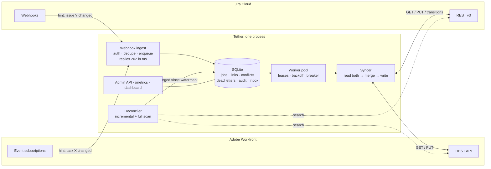

# Design note

## 1. Shape of the system



**Two paths in, one path out.** Webhooks are the fast path, giving sub-second latency when vendors behave. The reconciler
is the safety net that catches whatever webhooks miss. Both only *enqueue an item ID*. All real work happens in one
place, the syncer, and it always starts by re-reading both systems.

## 2. One sync run

```mermaid
sequenceDiagram
  participant Q as Queue
  participant S as Syncer
  participant DB as SQLite
  participant WF as Workfront
  participant J as Jira
  Q->>S: lease job wf:0042
  S->>WF: GET task
  S->>J: GET issue
  S->>DB: load target, seen[WF], seen[J], own[WF], own[J], open conflicts
  S->>S: merge → plan (writes per side, conflicts)
  S->>DB: recordRun(seen ← observed, target ← plan, own ← own ∪ writes)
  Note over S,DB: observations and intent are durable BEFORE any write
  S->>WF: GET again: abort if a field we're about to overwrite moved (emulated compare-and-set)
  S->>WF: PUT changed fields
  S->>J: GET again (compare-and-set), then PUT fields; transitions hop by hop (each hop added to own[J] first)
  S->>DB: commit(seen ← final values, own ← ∅) + audit + close conflicts
  S->>Q: complete (or re-arm if dirty)
```

A failure at **any** arrow is safe. The job is retried, the next run re-reads both systems, and the stored `own` values
tell the merge which of the values it finds were written by Tether rather than by a person.

## 3. The merge, and why it is not a textbook three-way merge

Per link, Tether stores:

| State | Meaning |
|---|---|
| `target` | what both systems should hold (after a successful run: what they do hold) |
| `seen[S]` | the value last **observed** in system *S*, recorded on every read even if the run then fails |
| `own[S]` | values Tether wrote (or *may* have written) to *S* since the last fully successful run, including intermediate workflow states |

The rule: **system S changed field f** ⇔ `current ≠ seen[S][f]` and `current ∉ own[S][f]`.

| WF changed | Jira changed | Decision |
|---|---|---|
| – | – | equal → nothing; different → **resume** an interrupted run (write `target`) |
| ✓ | – | propagate WF → Jira |
| – | ✓ | propagate Jira → WF |
| ✓ | ✓ | same value → nothing; else apply the field's **policy**: `workfront`, `jira`, `latest`, or `manual` (→ conflict inbox) |

### What the chaos simulation taught me (the actual history)

The first version was a classic three-way merge against one stored base, plus a single write-ahead "pending" value.
The scenario tests passed. Then the randomised simulation broke it within seconds, four separate times:

1. **Multi-hop transitions.** Moving Jira from *To Do* to *Done* takes three transitions. When the walk was interrupted at
   *In Progress*, the next run saw a value that was neither the base nor the pending value, so it concluded *"an engineer
   moved the card"* and propagated *In Progress* back over the marketer's *Done*.
   **Fix:** before making each hop, record it as one of our own values.
2. **Forgotten intent.** A second failed run with *different* writes replaced the first run's pending values. The first
   run's leftovers then looked like user edits. **Fix:** intents accumulate until a fully successful commit.
3. **Pagination.** The Workfront connector stopped paging when a page came back shorter than requested. The (mock) server
   capped pages below the requested size, so the reconciler silently never saw page 2, and with enough recent edits never
   advanced its watermark. This would have been a production bug. **Fix:** advance by what was received and stop only on
   an empty page.
4. **ABA.** A user changed a field and then changed it *back to the base value* while our write was in flight. Compared to
   the base, nothing had changed, so the interrupted write was finished and the user's latest choice was lost.
   **Fix:** compare each side to what we last *saw there*, not to a shared base. This is the shadow-copy idea from
   Neil Fraser's *Differential Synchronization* (2009), adapted to vendor APIs where writes can be ambiguous.

Each fix is now a named regression test in `test/merge.test.ts`.

Three more came later, while hardening for a real Jira site and running the live demo:

5. **Duplicates from search-index lag** (found by the simulation, once the mock was made realistic). Real Jira's
   search index trails writes by seconds. After a lost create response, a fast retry searched for the marker label,
   found nothing, and created a *second* issue. Once the mock Jira modelled index lag, the simulation produced
   duplicates in 35 of 50 seeds. **Fix:** after an ambiguous create, don't trust a negative search until the index lag
   has passed. The wait is a deferral, not a failed attempt, and `npm run preflight -- --deep` *measures* the real lag.
6. **The read→write race** (found by the live demo). A dashboard screenshot showed a due date that a human had just set
   being overwritten. Tether had read Workfront, then the human edited it, then Tether wrote its now-stale decision. The
   simulation couldn't see this because humans only acted *between* syncs. **Fix:** emulated compare-and-set, which
   re-reads the fields about to be overwritten and aborts if they moved. Then I **taught the simulation to make humans
   edit in the middle of a sync**, including a dedicated race phase. Without the fix, 50 of 50 seeds fail.
7. **JQL dates in the wrong timezone** (found while hardening for real Jira). JQL date literals are read in the API
   user's *profile* timezone, but Tether formatted them in UTC. For any user west of Greenwich, the reconciler would
   silently look into the future and miss changes. **Fix:** read the timezone from `/myself`. The mock's user now lives
   in Los Angeles, and a scenario catches the bug (an earlier version of that test didn't, because another code path
   masked it; the test was rewritten until the mutation failed it).

One non-bug finding: the metrics from the first real-mode run showed **124 issue reads in a minute of idle polling**.
The reconciler now compares search results with what it last saw and only enqueues real changes, which brings idle
polling to 0 reads.

The simulation has since passed 500 of 500 seeds.

## 4. Decision log

| # | Decision | Alternatives considered | Why this one |
|---|---|---|---|
| D1 | **State-based sync**: webhooks are hints, every run re-reads both sides | Event-sourced (apply webhook payloads in order) | Vendors give no ordering guarantee and deliver duplicates. Re-reading makes duplicates, delays and reordering harmless and gives crash recovery for free. Cost: 2 GETs per sync, which the benchmark puts at ~2 reads per no-op |
| D2 | **One job per item** (unique key) with a *dirty* flag | Queue of events | Natural coalescing (50 webhooks → 1 sync), per-item serialisation (no two workers on one item), and the dirty flag closes the "edit landed mid-sync" race |
| D3 | **SQLite** (WAL) as queue + state | Postgres, Redis, SQS | Zero infrastructure for a customer pilot, transactional, and survives restarts. Every query ports to Postgres (`claim` → `FOR UPDATE SKIP LOCKED`) when more than one replica is needed |
| D4 | **Field-level ownership table** in config | Global last-writer-wins; always ask a human | Matches how the customer actually works (marketing owns the brief, engineering owns status). LWW silently loses data; asking for everything floods the inbox |
| D5 | **Canonical model = intersection of capabilities** (date-only, ≤255 chars, plain text) | Preserve everything | A lossy mapping that isn't a fixed point causes infinite ping-pong. This is property-tested with 4,000 random round-trips |
| D6 | **Idempotent create** via marker label + write-ahead `creating` state | Trust the response | Jira has no idempotency keys. A lost create response is the classic duplicate generator. The simulation injects it hundreds of times per run |
| D7 | **Error taxonomy drives retries** (transient / rate-limited / circuit-open / permanent) | Retry everything N times | A 400 will never succeed (dead-letter now). An outage isn't the job's fault (defer without burning attempts). A 429 says *when* to come back |
| D8 | **Circuit breaker per vendor**, deferring rather than failing | Retry storm | During a Jira outage the queue just waits. Nothing gets dead-lettered and the backlog drains when Jira returns |
| D9 | **Never cascade deletes**: tombstone and comment | Mirror deletes | Deleting the wrong thing is unrecoverable; not deleting is cheap to fix |
| D10 | **In-process harness on a virtual clock** for tests | Docker Compose + real timers | Deterministic, seeded and fast (~0.15 s per simulated world). It exercises the real HTTP clients and routes via `fastify.inject` |
| D11 | **Mocks modelled on real API quirks**, not generic CRUD | Hit vendor sandboxes | No credentials needed, runs offline in the interview, and faults are controllable. The trade-off is fidelity, so research.md lists what to re-verify |
| D12 | **Emulated compare-and-set**: re-read the fields about to be written, abort on change | Accept the race; lock nothing | Neither API has `If-Match`. One extra GET per written side shrinks the lost-update window from a full sync to one round-trip. An abort is a deferral (not a failure), so it never dead-letters |
| D13 | **Contract tests run against both the mock and real Jira** | Trust the mock | The mock is only useful if it behaves like the vendor where it matters. The same suite runs in `npm test` (mock) and `npm run test:contract:real` |
| D14 | **Client-side fault injection** (`chaos-transport`) for real vendors | No chaos against real systems | You can't make Atlassian return 503s on demand, but you can make Tether's transport behave as if it did. That includes *real* writes whose response is then dropped |
| D15 | **Reconciler diffs search results against `seen`** | Enqueue everything in the overlap window | Same correctness (anything differing is enqueued; anything unmappable is passed through so the syncer surfaces it), at ~0 extra API calls when idle |
| D16 | **Replay = recorder on mocks, transports and structured logs**, not engine hooks | Instrument the engine | Keeps the engine clean, and proves the logs are sufficient to reconstruct what happened, which is what on-call needs |

## 5. Failure-mode matrix

| Failure | Detection | Handling | Proven by |
|---|---|---|---|
| Webhook lost | Reconciler finds the change; `tether_reconciler_repairs_total` rises | Repaired within one reconcile interval | `scenarios: every webhook is lost` + simulation (25% drop) |
| Webhook duplicated / replayed | `X-Atlassian-Webhook-Identifier` / body hash | 202 + `duplicate`, no job | `scenarios: dedupes` + simulation (20% dup) |
| Webhooks reordered or late | n/a, irrelevant by design | State-based re-read | simulation (reorder on) |
| Echo of our own write | Plan is empty | No-op, costs 2 GETs | `scenarios: echo webhooks…` |
| 5xx / timeout | Typed `TransientError` | Exponential backoff with jitter; dead letter after N attempts | simulation (10% errors) |
| 429 (with or without `Retry-After`) | `RateLimitedError` | Pause that vendor's gate; defer job without counting an attempt | `reliability: Retry-After` + simulation |
| Vendor outage | Circuit breaker opens | Jobs deferred, `/readyz` → 503 for alerting, auto-recovers via half-open probe | `scenarios: Jira outage` |
| Response lost *after* the write committed | Ambiguous `TransientError` | Retry is safe: `own` values plus the create marker prevent duplicates or reverts | `scenarios: lost response on create` + simulation (5% lost) |
| Crash mid-sync | Lease expires | Job reclaimed; `own` recognises half-applied writes | simulation (simulated crashes) |
| Interrupted multi-hop workflow | Hops recorded in `own[J]` | Resumes to target | `merge: interrupted multi-hop` |
| Same field edited on both sides | Both sides changed | Field policy, or the conflict inbox | `scenarios: conflicts` |
| Human edits a field after Tether read it, before Tether writes | Compare-and-set re-read | Abort, re-queue immediately, re-decide on fresh data | `scenarios: human edit landing between read and write` + simulation race phase |
| Jira search index lags behind a create | Marker search negative too soon after an attempt | Defer until the index lag has passed (measured by preflight) | simulation (mock models a 3 s lag) |
| JQL date read in the user's timezone | n/a, handled by design | Format JQL dates in the timezone from `/myself` | `scenarios: Jira-only change…` (user in Los Angeles) |
| Assignee e-mail hidden by Jira privacy settings | Lookup returns no e-mail | Stable placeholder identity → inbox, never "unassigned" | connector code path; `JIRA_USER_MAP` override |
| User exists on one side only | Lookup returns nothing | Conflict `unmapped_user`; re-checked on the next change | `scenarios: assignee only in Workfront` |
| Unknown status / bad data | `PermanentError` | Dead-letter immediately with a readable reason; replay after the fix | `scenarios: permanent error` |
| Counterpart deleted | 404 | Tombstone; comment on Jira; never delete | `scenarios: deleting…` |
| Title > 255 / rich text | Normalisation | No ping-pong | `mapping` property tests |
